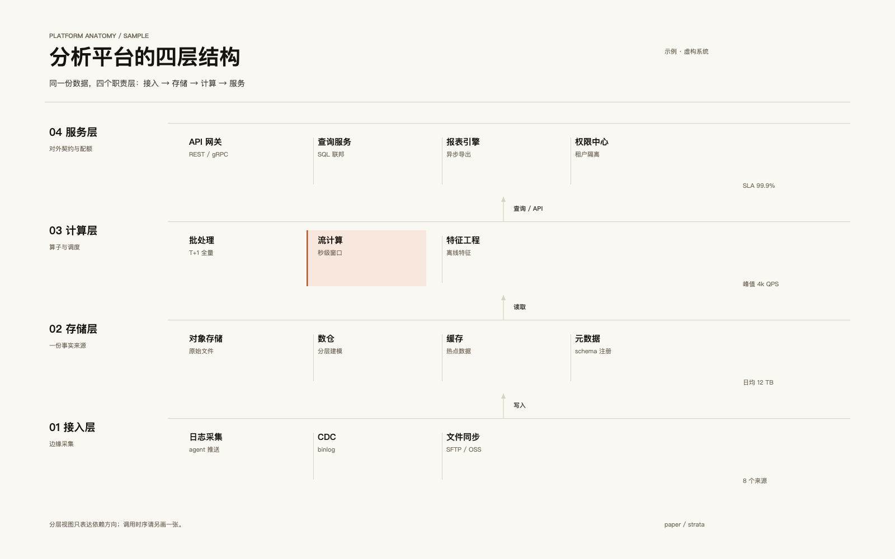
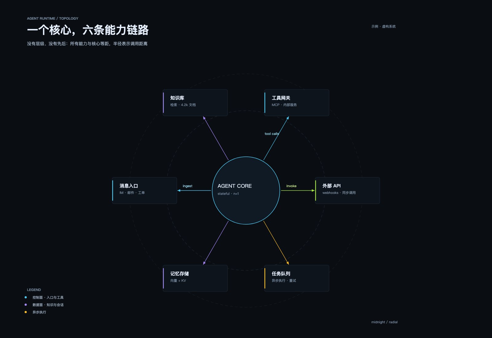
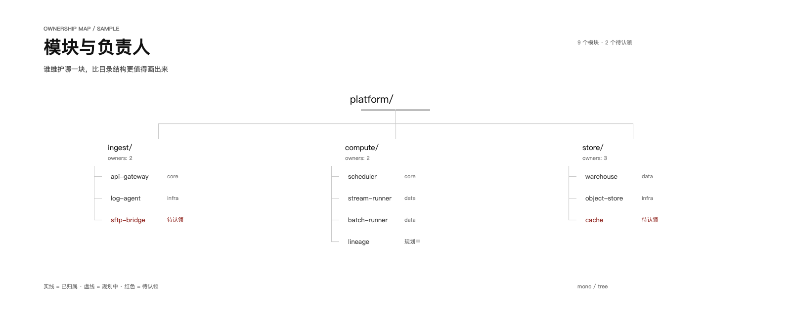

# architecture-board-builder

An agent skill for turning a system into a clear architecture diagram: **read the
structure, choose the visual language, then draw**. It ships a small Python toolkit
that writes `.drawio` files, a preview + lint loop, and the workflow for delivering
the result as a native editable [Feishu](https://www.feishu.cn) whiteboard (Lark board).

The kit imposes no house style — it gives you geometry, text metrics, four colour
themes and quality checks, so the layout can be shaped by the actual content.

| Layered strata | Radial topology | Typographic tree |
| --- | --- | --- |
|  |  |  |
| warm paper, hairlines, one tinted cell | dark technical, straight spokes | monochrome, rules only |

## How it thinks

1. **Name the structure** — layered, radial, tree, pipeline, states, matrix,
   anatomy, territory, timeline, comparison. If you cannot name it, the picture
   is not ready.
2. **Choose encoding + register** — one row of the mapping table, plus one register
   for the audience and medium (exec review, engineering deep-dive, doc
   illustration, slide, status). Then fix five decisions: ground, type voice, line
   language, accent budget, density.
3. **Draw, then look** — lint catches overflow, tiny fonts and low contrast; the
   PNG tells you whether the idea actually lands.
4. **Tests before shipping** — swap the project name (would it still be correct?),
   hide the text (does the geometry still speak?), and point at the subject within
   three seconds.

## Install

```bash
git clone git@github.com:ArveyKao/architecture-board-builder.git ~/skills-manager/architecture-board-builder
ln -s ~/skills-manager/architecture-board-builder ~/.claude/skills/architecture-board-builder
# or the directory your agent expects: ~/.codex/skills, ~/.qoder/skills, ~/.cursor/skills, ...
```

## Quick start

```bash
SK=/path/to/architecture-board-builder
mkdir -p /tmp/board && cd /tmp/board
cp "$SK/assets/examples/stacked_platform.py" board.py
python3 board.py                                    # -> stacked-platform.drawio
python3 "$SK/scripts/lint_board.py" stacked-platform.drawio
python3 "$SK/scripts/preview_svg.py" stacked-platform.drawio preview.html
"$SK/scripts/shot.sh" preview.html preview.png 1600 1000 2
```

Read `preview.png`, adjust, repeat. To deliver as a board:

```bash
python3 "$SK/scripts/serve_cors.py" 8766 /tmp/board
# in the Feishu board: ⋯ → 导入 → the .drawio (see references/feishu-whiteboard.md)
```

## Layout

```
SKILL.md                          what the agent loads when the skill triggers
references/structure-to-style.md  structure → encoding table, registers, anti-template tests
references/craft.md               style-independent craft: type, colour, lines, space, density
references/feishu-whiteboard.md   import / replace / verify, and the pitfalls
scripts/boardkit.py               primitives, four themes, text metrics, contrast-aware lint
scripts/preview_svg.py            draw.io → HTML/SVG preview
scripts/lint_board.py             overflow, font floor, off-canvas, contrast
scripts/shot.sh                   headless Chrome screenshot (1x/2x)
scripts/serve_cors.py             local CORS server for the import step
assets/examples/                  three builder scripts + .drawio + previews
```

## Notes

- Plain Python 3.9+, standard library only; the screenshot script needs Chrome or Chromium.
- The examples are fictional systems; the technique is the reusable part.
- Feishu's whiteboard importer accepts Draw.io (`.drawio`) and keeps shapes editable —
  which also means flat fills and strokes only: richer styling ships as PNG/SVG.

## License

MIT
