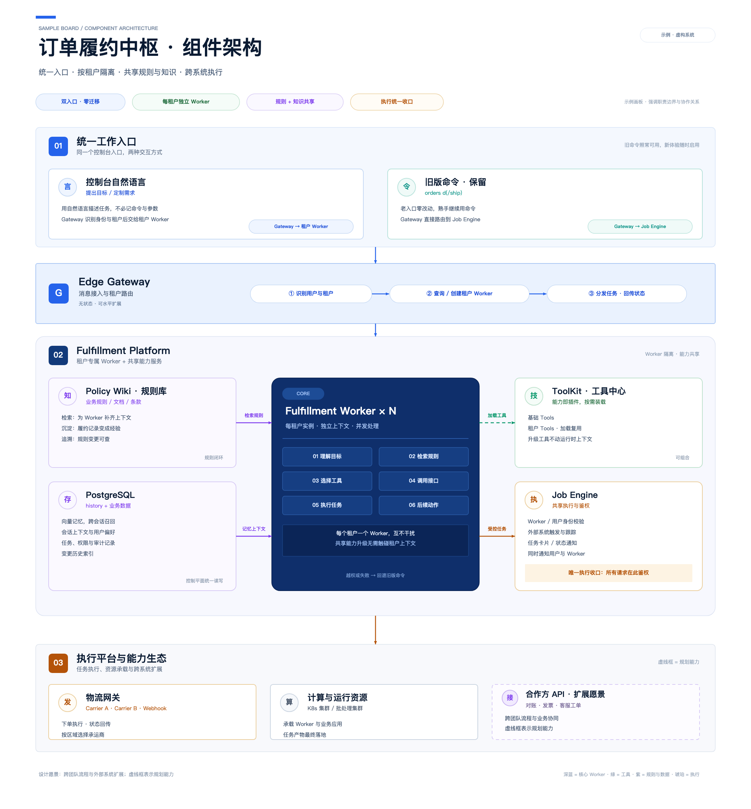

# architecture-board-builder

An agent skill for turning a system story into a **designed, editable architecture board** —
not a flowchart. It ships the design system, a small Python toolkit that writes `.drawio`
files, a local preview/lint loop, and the workflow for importing the result into a
[Feishu](https://www.feishu.cn) whiteboard (Lark board) as native editable shapes.



## What it does

- **Design concepts** — type scale, palette with meaning, card anatomy, numbered zones,
  arrow semantics, spacing formulas, three layout recipes, review checklist.
- **`boardkit`** — primitives (`section`, `card`, `badge`, `pill`, `circle`, `arrow`) that
  emit draw.io XML, with automatic text measurement.
- **Local loop** — render a PNG preview and lint for text overflow / tiny fonts *before*
  importing, so you never debug typography inside a whiteboard.
- **Delivery** — import into a Feishu board, replace existing content safely, verify, and
  keep the sources (`*.drawio` + preview + builder script) as the real backup.

## Install

The repo is the skill folder. Symlink it into your agent's skills directory:

```bash
git clone git@github.com:ArveyKao/architecture-board-builder.git ~/skills-manager/architecture-board-builder
ln -s ~/skills-manager/architecture-board-builder ~/.claude/skills/architecture-board-builder
# use the directory your agent expects: ~/.codex/skills, ~/.qoder/skills, ~/.cursor/skills, ...
```

Or point your agent at the cloned path directly.

## Quick start

```bash
SK=/path/to/architecture-board-builder
mkdir -p /tmp/board && cd /tmp/board
cp "$SK/assets/examples/order_platform.py" board.py
python3 board.py                                    # -> order-platform.drawio
python3 "$SK/scripts/lint_board.py" order-platform.drawio
python3 "$SK/scripts/preview_svg.py" order-platform.drawio preview.html
"$SK/scripts/shot.sh" preview.html preview.png 2100 2260 2
```

Open `preview.png`, adjust the builder, repeat. Then import:

```bash
python3 "$SK/scripts/serve_cors.py" 8766 /tmp/board
# in the Feishu board: ⋯ → 导入 → pick the .drawio (see references/feishu-whiteboard.md)
```

## Layout

```
SKILL.md                     what the agent loads when the skill triggers
references/design-system.md  board concepts: type, color, card anatomy, recipes, checklist
references/feishu-whiteboard.md  import / replace / verify, and the pitfalls
scripts/boardkit.py          draw.io primitives + palette + text metrics
scripts/preview_svg.py       draw.io -> HTML/SVG preview
scripts/lint_board.py        overflow, font floor, off-canvas
scripts/shot.sh              headless Chrome screenshot (1x/2x)
scripts/serve_cors.py        local CORS server for the import step
assets/examples/             reference builder, board and preview
```

## Notes

- Everything is plain Python 3.9+ and stdlib only; the screenshot script needs Chrome or Chromium.
- The example board is a fictional order-fulfilment system; swap in your own content.
- Feishu's whiteboard importer supports Draw.io (`.drawio`); imported shapes stay editable.

## License

MIT
